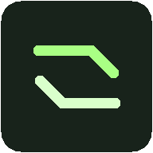
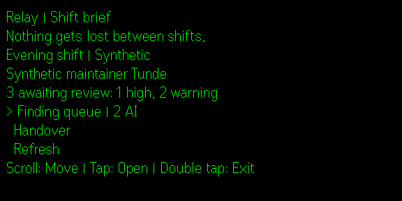
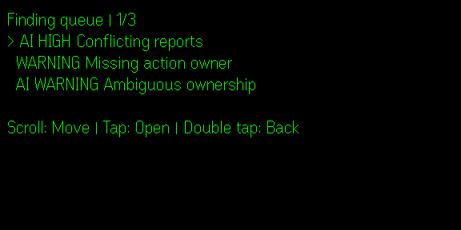
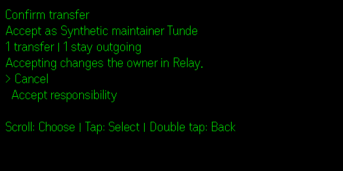
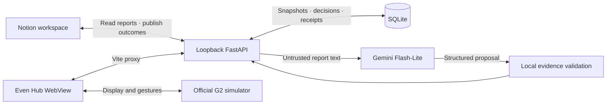

# Relay



**Nothing gets lost between shifts.**

Relay is a shift handover app for Even G2. It turns scattered operational reports into a short, evidence-backed brief. An incoming operator can compare the original accounts, acknowledge a finding, and explicitly take responsibility for outstanding work. Relay writes the verified outcome back to Notion.

**Heads Up: Even Realities Hackathon by TVM Ventures & Daos Hub · Track 04 — AI Assistants & Work**

## A handover you can act on at the equipment

Facilities maintenance, hospitality operations, and other shift-based teams often inherit work across reports, task lists, and conversations. At the pump or loading dock, finding the current risk and the person responsible can mean stopping to search through a phone. Relay puts the priority, cited evidence, and next decision on the glasses. Short views and deliberate gestures keep the operator’s attention on the handover.

| Incoming shift brief | Prioritized finding queue | Transfer confirmation |
| --- | --- | --- |
|  |  |  |

*Actual Even Hub simulator captures using synthetic data.*

1. **Read.** Relay imports Notion reports. Deterministic checks flag operational gaps, and Gemini Flash-Lite can propose semantic findings such as conflicting observations from the same pump test. Relay checks citations against the stored source.
2. **Review.** The operator compares excerpts and acknowledges or rejects the proposed finding. Citation validation establishes provenance. The human reviewer judges what the evidence means.
3. **Write.** A separate confirmation starts with Cancel selected. After acceptance, SQLite commits the eligible ownership transfer and verifies the receipt. Relay can then publish the receipt, update the current owner in Notion’s Action Register, and retain an ownership audit event. A pending sync remains visible on the wearable.

## Quick start

Install Python 3.12, uv, Node.js 22.12+ in the 22.x line, and npm. On Ubuntu under WSL2, enable WSLg and install the `libwebkit2gtk-4.1-0` simulator runtime. The demo script installs the locked backend dependencies and prints the Vite and official simulator commands.

```bash
bash scripts/demo.sh offline
```

Run the printed commands in separate terminals. Offline mode runs a deterministic synthetic handover without provider credentials. For the live demo, use the [dedicated Notion workspace and Gemini setup](backend/README.md#notion-demo), keep credentials in ignored `backend/.env` (see [.env.example](backend/.env.example)), and run:

```bash
bash scripts/demo.sh live
```

Use the [demo workflow](docs/DEMO.md) to import, analyze, and publish. Use the [storyboard](docs/submission/STORYBOARD.md) for exact recording steps. Each run isolates local SQLite data and preserves earlier receipts.

## Architecture



## Verification and limits

The frozen synthetic benchmark completed **30/40** live cases. Finding precision was **94.1% (16/17)** and end-to-end recall was **84.2% (16/19)** across all attempted positive labels. Citation checks passed **17/17** and case-level false positives were **1/14** completed negatives. A separate recovery run completed **9/10** previously incomplete cases. The original results and failure counts remain intact. [Benchmark](backend/evals/results-phase5.md) · [Recovery](docs/AI-RECOVERY.md)

CI runs the locked Python and frontend suites, deterministic citation checks, TypeScript, Vite build, and Even Hub packaging. [GitHub Actions](https://github.com/vaadewoyin/relay/actions) · [Backend checks](backend/README.md) · [Frontend checks](frontend/README.md)

The live Notion, Gemini, and gesture workflow was verified in the official simulator. Physical G2 use and companion installation remain unverified. Voice is deferred because the simulator run did not verify speech input. The demo API trusts synthetic actor context and stays on loopback. A shared deployment needs authentication, record-level authorization, HTTPS, and explicit phone WebView network configuration. [Wearable design](docs/WEARABLE.md) · [Voice feasibility](docs/VOICE.md) · [Deployment limits](frontend/README.md#simulator-and-physical-networking)

## Build-week disclosure and license

Pre-existing components used include the official Even Hub starter, SDK, CLI, and simulator, along with TypeScript, Vite, Python, FastAPI, Pydantic, SQLite, and the Notion and Gemini APIs and their client tooling. The Even Realities starter supplied the initial WebView and build scaffold. Relay’s workflow, backend, screens, fixtures, and documentation are original project work. This repository’s first recorded Relay commit is November 26, 2026. The disclosure describes the recorded project and upstream inputs.

Relay’s original code is [MIT licensed](LICENSE). The [starter notice](frontend/LICENSE) and [SDK notice](frontend/public/EVEN-HUB-SDK-LICENSE.txt) retain their upstream attribution. [Third-party inventory](docs/submission/LICENSES.md) · [Submission checklist](SUBMISSION.md)
