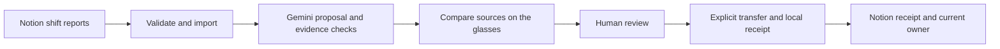

# Relay demonstration

**Nothing gets lost between shifts.** An incoming facilities operator needs to know which equipment still needs attention and who owns the remaining work. Relay shows the conflicting evidence, asks the operator to acknowledge it, and records an explicit transfer with a receipt.

## Prepare and repeat

From the repository root, run `bash scripts/demo.sh live` after the [private Notion workspace setup](../backend/README.md). Follow the printed Vite and simulator commands. The seed uses the same three synthetic Notion reports. It creates a new local database and does not delete previous receipts, action history, or source reports. The offline command is `bash scripts/demo.sh offline`. It is useful for rehearsing transfer and recovery without Gemini or Notion.

Use the local Swagger UI to verify Notion, import, then submit one analysis for the outgoing shift. Keep the simulator on the shift brief until the analysis completes. During recording use the already-prepared queue. In a repeat run, restart Vite or use a fresh origin if the simulator still has a receipt pointer to a previous isolated database.

## Suggested recording

| Time | Show |
|---|---|
| 0:00–0:25 | Day and evening shifts. In Notion, one operator saw pump P-17 stall while another saw a sustained discharge during the same 13:35 test. The bypass inspection remains unassigned. |
| 0:25–1:05 | Relay’s incoming brief, high-severity AI proposal, and both original Notion excerpts. Scroll once to compare, then tap to open review. |
| 1:05–1:35 | Cancel is initially selected. Acknowledge the finding, return to the shift brief, and inspect the handover preview. |
| 1:35–2:05 | Confirm responsibility separately. Show one transferred task, one outstanding task, and the persistent local receipt marked sync pending. |
| 2:05–2:45 | Publish the stored receipt from Swagger. Reopen it on the glasses. Show the Notion receipt and the stable Action Register row whose owner is now the incoming operator. |

The recording can keep setup and provider latency off screen while showing actual recorded results. Screen captures are from the official simulator. The paired-phone and physical G2 deployment paths remain unverified.

